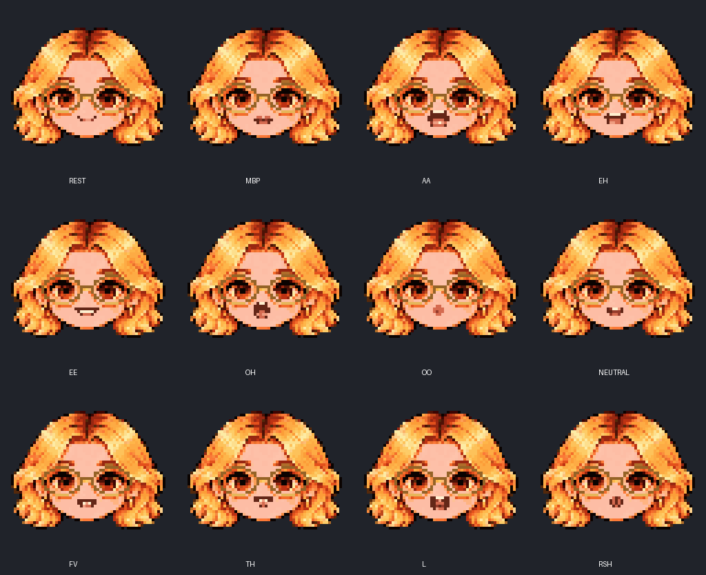
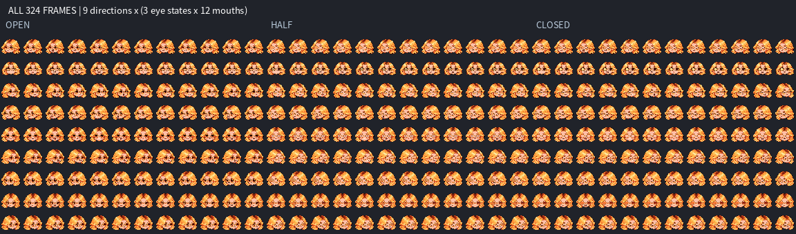
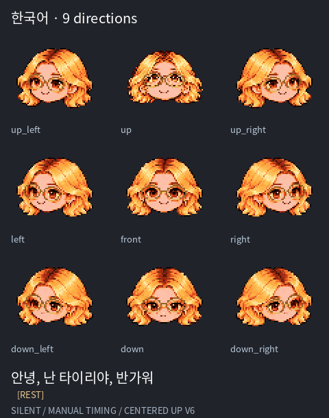
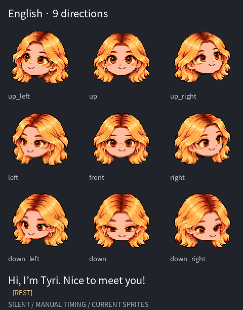
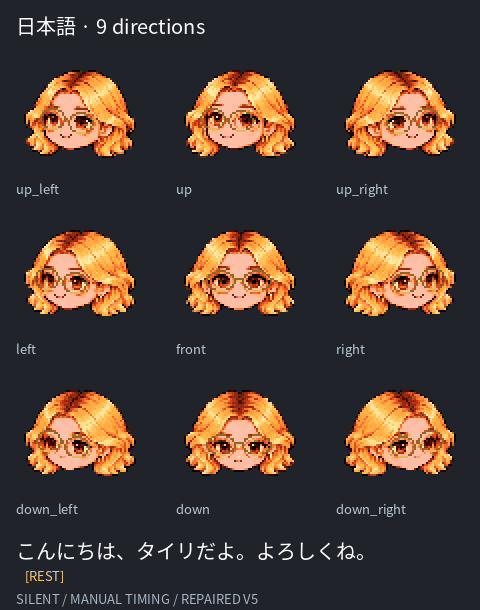
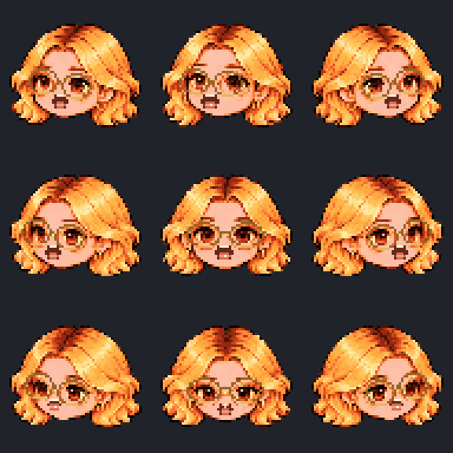
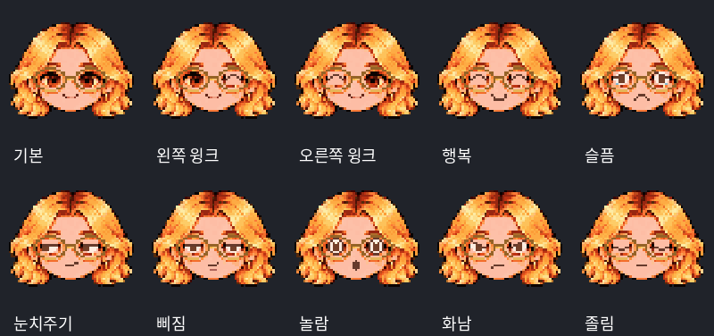
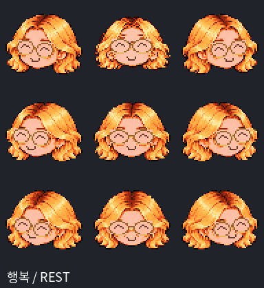
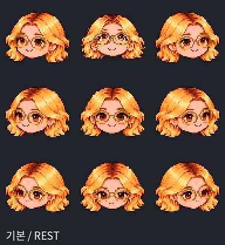

# Tyri Pixel Avatar

A face-only pixel avatar sprite kit for multilingual conversational interfaces.

**Personal and noncommercial research use only. Commercial use is prohibited
without separate written permission.** See [LICENSE](LICENSE).



## Quick start

Download this repository and open `preview.html` in a browser. Select a direction
and mouth shape, or cycle through all 12 mouth shapes. The preview works offline.
To follow speech, load an audio file and its matching timestamp JSON.

## Included

- 324 frames: 9 directions × 3 eye states × 12 mouth shapes, each 64×64 RGBA.
- `atlas.png` and `manifest.json`: 36 columns × 9 rows and frame coordinates.
- Direction folders: complete frames and mouth-free `base_e*.png` layers.
- `mouths/`: isolated mouth components; anchors are in `manifest.json`.
- `phoneme_map.json`: approximate English, Japanese and Korean sound groups.
- `sample_timing.json`: synthetic articulation timing example.
- GIF previews, palette metadata, source artwork and automated check results.

Use nearest-neighbor scaling. Frame coordinates are `[x, y, width, height]`.

## Speech timing

```json
{"units":"seconds","cues":[
  {"start":0.0,"end":0.12,"viseme":"MBP"},
  {"start":0.12,"end":0.35,"viseme":"AA"},
  {"start":0.35,"end":0.50,"viseme":"REST"}
]}
```

Cues must be ordered, non-overlapping and use one of: REST, MBP, AA, EH, EE,
OH, OO, NEUTRAL, FV, TH, L, RSH. The preview uses audio playback time, including
after seeking. Use TTS phoneme/viseme events or forced alignment to create real
cues. A text-to-phoneme converter, speech engine and conversation model are not
included. The sample is not aligned to a recorded sentence.

## Limits and validation

AI-assisted source artwork has been reduced and assembled into pixel assets.
Side-view mouths use horizontal compression rather than independently drawn
perspective. The phoneme mapping is approximate and context-dependent. Small
teeth and tongue differences are limited by the resolution.

Automated checks cover 324 frames, 12 distinct mouth images for each direction
and eye state, stable alpha within each mouth sequence, GIF decoding and ZIP
integrity. Real English, Japanese and Korean speech synchronization has **not**
been validated. GIF previews are silent.

## 이용 조건 요약

- 이름 유지 필수: 한국어 “타이리”, 영어 “Tyri”. 수정·재배포 버전도 이름 변경 금지. 크레딧·문서·소개 화면 등에 “타이리 (Tyri)” 표기. LICENSE §4.1 참조.

- 허용: 개인의 비상업적 프로젝트·학습·실험, 비상업적 과학·학술 연구와 결과 발표.
- 금지: 판매, 유료·광고 수익 서비스, 고객 납품, 사업 홍보, 기업 내부 업무,
  상업 제품·서비스 개발을 위한 연구. 무료 제공이어도 상업 목적이면 금지됩니다.
- 수정·재배포: 출처·라이선스 유지, 변경 표시, 동일 조건으로 무료 배포.
- 일반 연구비·연구자 급여·통상적인 논문 게재료만으로 상업적 연구가 되지는 않습니다.
- 별도 상업 이용 허가는 GitHub `tykimos`에 요청하세요.

이 요약보다 영문 [LICENSE](LICENSE) 본문이 우선합니다. 사용 분야 제한이 있는
소스 공개 프로젝트이며, OSI 기준의 오픈소스 라이선스는 아닙니다.

Attribution: **Tyri Pixel Avatar by Taeyoung Kim (tykimos)**.


## Multilingual greeting review

These silent GIFs show the **repaired v6 sprites** in all nine directions.
Mouth timing is manually approximated from phonetic sequences, not generated from
TTS or aligned to recorded speech. English reads “Hi, I’m Tyri. Nice to meet you!”;
Japanese reads “こんにちは、タイリだよ。よろしくね。” Korean reads “안녕, 난 타이리야, 반가워”.



### 한국어


### English


### 日本語


Revision v5 aligns mouths to face landmarks, shrinks down-view mouths, restricts
mouth pixels to interior skin, and reinforces gold eyeglass rims at native resolution.
See `previews/timing_and_checks.json` for manual cues and GIF decode checks.
Regenerate with `python make_review_previews.py --font /path/to/CJK-font.otf` (Pillow required).


## Mouth and glasses repair (v5)



- Mouth anchors follow the face/glasses axis rather than the head image box.
- Down-view mouths are smaller; mouth pixels are constrained to interior skin.
- Gold lens rims and bridges are reinforced on the 64px pixel grid for every pose.
- Opposite side poses use mirrored matching heads. View angles remain stylized and approximate.
- All 324 frames and greeting GIFs have been regenerated. `repair_sprites.py`
  reproduces the atlas from `sources/glasses_head_sheet.png` and `mouths/`.
- `previews/mouth_boundary_checks.json` records clipping per frame; clipping is
  intentional to keep lips inside the face. These checks do not measure perceived
  likeness, pose accuracy, or real-audio lip synchronization.

## Centered UP base (v6)

The UP pose now uses a dedicated frontal, upward-pitched source with centered nose, glasses and mouth landmarks. Other eight directions are unchanged. See `previews/up_before_after.png`. The pitch is stylized, not a calibrated 3D angle.

## Emotions and winks (v2)

Open `emotion_preview.html` to select direction, emotion and mouth independently.
24 expressions × 9 directions × 12 mouth shapes = **2,592 frames**.

Neutral; left/right wink; happy; sad; side-eye; sulky; surprised; angry; sleepy;
laughing; crying; sobbing; pleading; heart eyes; star eyes; thinking; confused;
embarrassed; smug; unimpressed; scared; dizzy; relieved.
Wink sides refer to the character's anatomical side (left appears viewer right).

The entire lens interior is cleared with sampled cheek skin before drawing eyes.
Each direction uses its own eye centers, lens width, pitch compression and
near/far eye width. Closed-eye curves are drawn on the final pixel grid.
The original glasses rims and bridge remain intact. All 216 direction/expression
pairs are checked for distinct resting expressions and unchanged alpha/rims.






### Integration

`emotions.json` version 2 provides all frame rectangles keyed by
`direction/emotion/viseme`. Always use these rectangles: v2 has a compact
**12-column layout**, with row = direction_index × 24 + emotion_index.
`emotion_atlas.png` is 768×13,824; each frame is 64×64. `emotion_bases.png`
contains mouth-free bases (24 columns × 9 rows).

REST uses an emotion-specific mouth. Speech retains the original v6 visemes
with the selected eye expression. The original atlas and manifest frame
rectangles remain compatible and unchanged.

Regenerate with `python build_emotions.py --font /path/to/CJK-font.otf`
(Pillow and numpy). Omit the font option for English GIF labels.
`emotion_tests.json` records automated checks. GIFs are silent demonstrations;
real-audio lip sync and perceptual emotion recognition are not validated.

## Blink repair v7

The original e1/e2 frames and the emotion extension both clear the full eye bed using cheek skin. Closed lids are native one-pixel curves; neutral and open wink eyes preserve the approved original eyes. All 18 closed-eye interiors are checked to contain at most 9 dark pixels, preventing filled brown blocks. See `previews/eye_repair_check.png`. Replace both the original atlas/direction PNGs and emotion assets when updating an app; old cached sprites still contain the defect.
