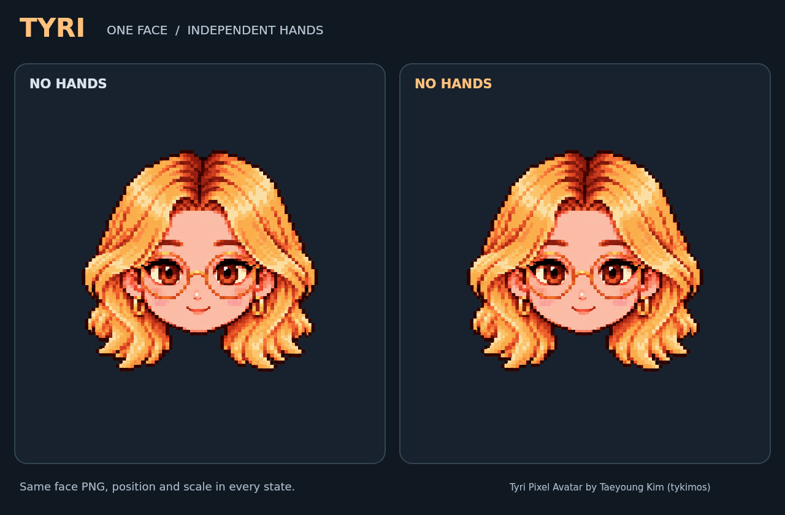

# 타이리 (Tyri) — 얼굴과 손을 분리한 픽셀 아바타

**하나의 얼굴을 같은 크기·위치에 고정하고, 투명한 손 스프라이트를 별도로 움직입니다.** 손이 나타나거나 사라져도 얼굴 크기가 달라지지 않습니다.



[미리보기 파일](index.html) · [MP4 보기](previews/layered-hero.mp4) · [분리된 파츠 보기](previews/layered-parts.png) · [얼굴 PNG](assets/sprites/face/neutral.png) · [손 PNG 폴더](assets/sprites/hands) · [좌표·동작 JSON](data/layers.json)

## 바로 사용하기

1. [저장소 ZIP](https://github.com/tykimos/tyri-pixel-avatar/archive/refs/heads/main.zip)을 내려받아 전체 압축을 풉니다.
2. `index.html`을 브라우저에서 엽니다. **미리보기에는 서버, 빌드, npm 설치가 필요하지 않습니다.**
3. 왼쪽의 **손 없음**과 오른쪽의 **손동작**을 같은 크기 캔버스로 비교합니다. 처음에는 손 흔들기가 선택됩니다.
4. 합성 / 얼굴만 / 손만, 체크 / 흰색 / 어두운 배경, 얼굴 기준선을 전환합니다. 화면 아래에서 현재 얼굴·손 PNG를 받을 수 있습니다.

GitHub의 HTML 파일 페이지에서는 앱이 실행되지 않습니다. 다운로드한 폴더 안에서 열어 주세요. `data/layers.js`를 직접 읽으므로 오프라인에서도 작동합니다.

## 포함된 스프라이트

| 파츠 / 동작 | PNG 수 | 기본 재생에 사용 | 구성 |
| --- | ---: | ---: | --- |
| 고정 얼굴 | 1 | 1 | 정면 중립 얼굴, 1254 × 1254 |
| 손 흔들기 `wave` | 3 | 3 | 오른손 |
| 브이 `peace` | 3 | 2 | 오른손 2개 + 왼손 대체 포즈 1개 |
| 쉿 `shush` | 3 | 3 | 오른손 |
| 하트 `heart` | 3 | 3 | 양손을 묶은 그룹 |
| 글쓰기 `write` | 3 | 3 | 양손·연필·수첩을 묶은 그룹 |
| 생각하기 `think` | 3 | 3 | 오른손 |
| **합계** | **19** | **18** | 얼굴 1개 + 손 PNG 18개 중 17개 재생 |

손 PNG는 각각 **418 × 418**, 실제 알파 투명 배경입니다. 왼손 브이 파일은 보존된 대체 파츠이며 기본 오른손 애니메이션에 섞이지 않습니다. 각 동작은 파츠를 여러 번 참조하는 9개 재생 프레임으로 구성되며, 3.2초 단위로 반복됩니다.

**하트의 두 손과 글쓰기의 손·소품은 각 PNG 안에서 하나의 그룹입니다.** 얼굴과는 독립적으로 배치되지만, 그룹 안의 손가락·각 손·연필·수첩을 개별 조작하는 구조는 아닙니다.

## 얼굴 크기를 고정하는 방식

- 캔버스는 항상 **1024 × 1024**입니다. 브라우저 화면 크기는 CSS로만 조절합니다.
- 얼굴 파일과 변환은 `head.sprite`, `head.transform` 한 곳에 있으며 `head.locked = true`입니다. 손의 범위에 맞춰 얼굴을 다시 확대·축소하는 자동 맞춤은 없습니다.
- 얼굴의 의미 있는 알파 영역(`alpha ≥ 128`)은 `content_bbox: [249, 252, 749, 703]`입니다. 이 영역의 표시 폭은 **680px**로 고정됩니다. 원본 PNG 전체의 투명 여백은 기준선 계산에서 제외합니다.
- 애니메이션에는 손 인스턴스만 허용합니다. 얼굴 참조나 얼굴 변환 덮어쓰기는 검증 단계에서 거부합니다.
- `side: left/right`는 **캐릭터의 해부학적 좌우**입니다. 화면의 왼쪽·오른쪽 또는 앞뒤 가림 순서를 뜻하지 않습니다.
- 가림 순서는 `z`로 정합니다. 뒤쪽 손은 `z < 100`, 얼굴은 `z = 100`, 앞쪽 손은 `z > 100`입니다. 현재 제공하는 손동작은 얼굴 앞에 합성합니다.

### 최소 통합 예제

저장소 루트에 HTML 파일을 만들면 아래처럼 사용할 수 있습니다. `faceVisible`, `handsVisible`로 각 레이어 표시를 바꿔도 얼굴 변환은 유지됩니다.

```html
<canvas id="tyri" width="1024" height="1024"></canvas>
<script src="data/layers.js"></script>
<script src="layered-player.js"></script>
<script>
(async () => {
  const m = window.TYRI_LAYERS, player = window.TyriLayeredPlayer;
  const ctx = document.getElementById('tyri').getContext('2d');
  const entries = await Promise.all(Object.entries(m.sprites).map(([id, s]) =>
    new Promise((resolve, reject) => {
      const image = new Image();
      image.onload = () => resolve([id, image]);
      image.onerror = () => reject(new Error(s.path));
      image.src = s.path;
    })
  ));
  const images = Object.fromEntries(entries), start = performance.now();
  function frame(now) {
    const commands = player.getDrawCommands(m, 'wave', now - start, {
      faceVisible: true, handsVisible: true
    });
    player.drawContext(ctx, commands, images);
    requestAnimationFrame(frame);
  }
  requestAnimationFrame(frame);
})().catch(console.error);
</script>
```

## 검증과 재생성

[실제 렌더 검증 결과](docs/layered-render-validation.json)는 7개 상태의 프레임 시작·반복 경계 **62개 표본을 모두 통과**했습니다. 얼굴 단독 RGBA가 동일하고, 합성 화면에서 손에 가리지 않은 픽셀이 얼굴과 일치하며, 레이어를 숨겼을 때 잔상이 남지 않는 것을 검사합니다. 손이 얼굴을 가리는 합성 픽셀은 얼굴 단독 화면과 달라지는 것이 정상입니다.

```sh
npm install
npm test
npm run test:pixels
python3 -m pip install -r requirements.txt
python3 -m unittest discover -s tests
```

Node 픽셀 검증·미리보기 렌더에는 `@napi-rs/canvas` **0.1.100**을 사용합니다. 위 개발 의존성은 브라우저 미리보기 실행에는 필요하지 않습니다.

```sh
python3 scripts/build_layered_assets.py  # 보관한 원화에서 셀·좌표 기록 재추출
npm run preview:render                 # GIF/MP4 미리보기 생성; FFmpeg 필요
```

얼굴·손 원화를 새로 생성하고 투명도와 손 방향을 수정한 제작 과정을 [이미지 생성 기록](docs/sprite-generation.json)에 남겼습니다. 빌더는 보관된 원화의 셀을 자르고 배치 정보를 작성하며 원화 픽셀을 다시 그리지 않습니다.

## 현재 지원 범위와 이전 자료

새 레이어 구성은 **정면 중립 얼굴 1개와 손동작 6종**입니다. 얼굴의 방향·표정·입 모양을 독립 조합하거나 음성에 자동 립싱크하는 기능은 포함하지 않습니다. 모든 동작의 양손·손바닥·손등 변형도 제공하지 않습니다.

이전 방향·표정·발음 및 얼굴+손 완성형 시트는 [원본 시트 미리보기](reference.html)와 [이전 자료 안내](SOURCE_ATLASES.md)에 보존했습니다. 이 참고용 시트들은 새 고정 얼굴 레이어에 자동으로 연결되지 않습니다.

## 이름·출처·이용 조건

캐릭터 이름 **타이리 / Tyri**를 유지해 주세요. **Tyri Pixel Avatar by Taeyoung Kim (tykimos)** · [원본 저장소](https://github.com/tykimos/tyri-pixel-avatar).

기존 [Tyri Personal and Noncommercial Research License 1.1](LICENSE)을 그대로 적용합니다. 개인 비상업적 사용 및 비상업적 연구를 허용하며, 상업적 사용에는 별도 서면 허가가 필요합니다. 재배포 시 이름·출처·라이선스를 함께 유지해야 합니다.
