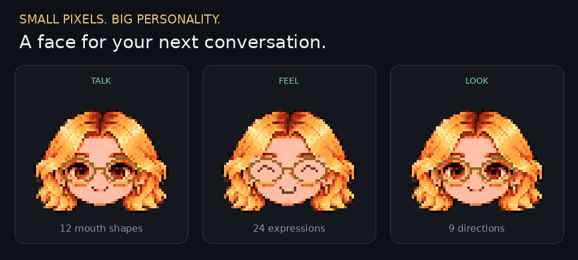
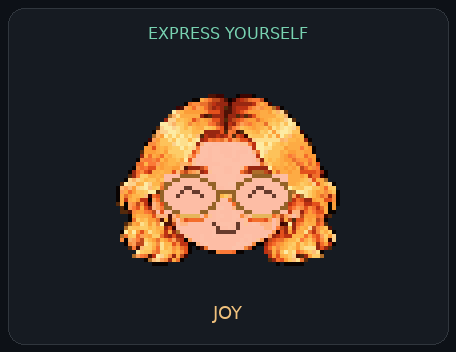
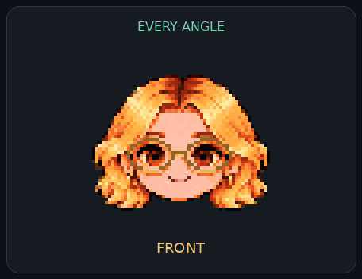

<div align="center">

# Tyri Pixel Avatar

### Small pixels. Big personality.

A tiny, expressive face for conversational interfaces, virtual companions, and creative experiments.

**9 directions · 24 expressions · 12 mouth shapes · 64 × 64 pixels**

[Get started](#get-started) · [Sprite guide](GUIDE.md) · [Animation gallery](previews/README.md) · [License](LICENSE)



**말하고, 웃고, 윙크하고, 고개를 돌리는 픽셀 캐릭터.**

Personal & noncommercial research use only.

</div>

## One face, many ways to react

<table>
<tr>
<td align="center" width="50%">

<br><strong>A little more personality.</strong><br>
Joy, tears, winks, heart eyes, a little attitude—and more.
</td>
<td align="center" width="50%">

<br><strong>A different point of view.</strong><br>
Look up, down, left, right, and between. Keep talking.
</td>
</tr>
</table>

- **Mix expression and speech.** Select a mood and a mouth shape independently.
- **Keep the pixels crisp.** Transparent 64 × 64 frames, shown above at integer scale.
- **Start small, build your own.** PNG atlases, JSON coordinates, source artwork, and offline HTML previews.
- **Explore three languages.** Approximate mouth mappings and sample greetings for Korean, English, and Japanese.

*GIFs are silent, scripted demonstrations. Speech recognition, TTS, and a conversation model are not included; real-audio lip sync has not been validated.*

## Get started

```bash
git clone https://github.com/tykimos/tyri-pixel-avatar.git
cd tyri-pixel-avatar
```

Open either file locally in your browser—no build step required:

| Preview | Try it |
| --- | --- |
| `emotion_preview.html` | Choose a direction, expression, and mouth; cycle expressions or test mouth animation. |
| `preview.html` | Test blinking and mouth shapes, or load an audio file with matching cue JSON. |

You can also download the repository with **Code → Download ZIP**, unzip it, and open the same files.

## Build with Tyri

Choose the atlas that fits your prototype:

| Kit | Frames | Files |
| --- | ---: | --- |
| **Core** · 9 directions × 3 eye states × 12 mouths | 324 | [`atlas.png`](atlas.png) + [`manifest.json`](manifest.json) |
| **Expressions** · 9 directions × 24 expressions × 12 mouths | 2,592 | [`emotion_atlas.png`](emotion_atlas.png) + [`emotions.json`](emotions.json) |

Use the JSON frame rectangles instead of hard-coded offsets. For example:

```js
// Load emotions.json and emotion_atlas.png first.
const [x, y, w, h] = emotions.frames["front/wink_left/AA"];
ctx.imageSmoothingEnabled = false;
ctx.drawImage(atlasImage, x, y, w, h, 0, 0, w * 4, h * 4);
```

**[Read the integration guide →](GUIDE.md)** for cue timing, frame layout, regeneration commands, and limitations.

<details>
<summary><strong>Explore all expressions and validation previews</strong></summary>


[24-expression contact sheet](previews/emotions_contact.png) · [All-direction emotion GIF](previews/emotions_9directions.gif) · [Wink GIF](previews/winks_9directions.gif) · [Eye checks](previews/eye_repair_check.png)

[한국어 greeting](previews/greeting_ko_9directions.gif) · [English greeting](previews/greeting_en_9directions.gif) · [日本語 greeting](previews/greeting_ja_9directions.gif)

Automated checks cover frame consistency, alpha preservation, distinct mouth states, and eye/glasses regressions. Direction angles and mouth projections are stylized approximations. See [`test_results.json`](test_results.json), [`emotion_tests.json`](emotion_tests.json), and the [guide](GUIDE.md).

</details>

## License & credit

**Personal and noncommercial research use only. Commercial use requires separate written permission.** This is a source-available project with a custom license, not an OSI-approved open-source license. See [LICENSE](LICENSE) for the full terms.

개인 비상업적 프로젝트·학습·실험 및 비상업적 학술 연구에 사용할 수 있습니다. 상용 서비스·고객 납품·기업 내부 업무 등은 별도 허가가 필요합니다.

Created by **[Taeyoung Kim · tykimos](https://github.com/tykimos)**. AI-assisted source artwork, assembled into programmable pixel sprites.

If Tyri helps your experiment, a star or a short demo in an issue is welcome.
