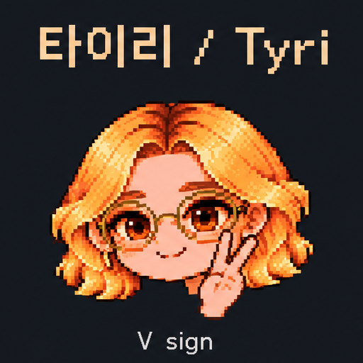

# 타이리 / Tyri — 고해상도 분할 업로드

첫 승인 시트를 512×512 PNG 6개로 분리해 업로드했습니다. 축소하지 않은 원본 좌표 기반 조각이며, 제목과 라벨이 포함됩니다. 독립 투명 손/얼굴 레이어가 아닙니다.

|동작|이미지|
|---|---|
|손흔들기||
|V||
|쉿||
|하트||
|글쓰기 초기 시안||
|뒤쪽 손흔들기||

원본 배치 좌표: [manifest.json](manifest.json). 글쓰기는 초기 승인 시안이므로 이후 수첩 가림 수정본을 우선해야 합니다. 기존 LICENSE와 타이리 / Tyri 이름 유지 조건이 적용됩니다.
